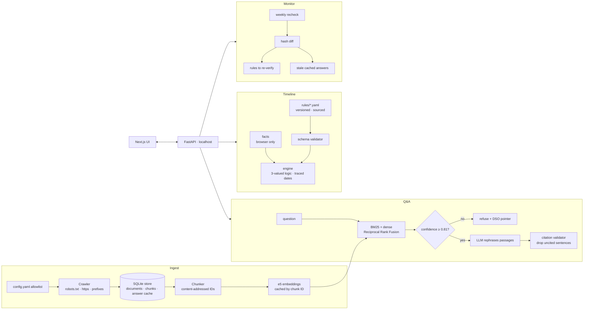

# F-1 Compliance Copilot

**Cited answers and personal deadline timelines for international students on F-1 visas.**

International students make high-stakes decisions, like when to file for OPT, how long they can stay after graduating, or whether their travel signature is still valid, based on guidance scattered across USCIS, DHS and university pages, plus a lot of group-chat rumor. This tool:

- **answers questions only from official sources**, in English, Chinese, Hindi, Korean or Spanish, with a citation on every sentence, and **refuses instead of guessing** when the sources don't cover a question;
- **computes a personal timeline** (OPT filing window, grace period, STEM extension, travel signature, reporting deadlines, Form 8843) with a **deterministic rules engine**. Dates never come from an LLM, and each one shows its arithmetic and its source;
- **watches the official pages for changes** and flags the rules and cached answers that depend on them;
- **keeps personal data on the user's device.**

> **This is an information tool, not legal advice.** Always confirm with your school's Designated School Official (DSO).

## Results

Evaluated on a 50-question multilingual set (30 English, 12 translated into zh/hi/ko/es, 8 off-topic) against a frozen snapshot of 532 passages from USCIS, Study in the States and ICE SEVP (`eval/results/latest.md`, Nov 2026):

| slice | n | recall@1 | recall@5 | MRR@10 |
|---|---|---|---|---|
| overall | 41 | 0.756 | **0.902** | 0.827 |
| English | 29 | 0.828 | **0.931** | 0.876 |
| Hindi / Korean | 3 / 3 | — | 1.000 / 1.000 | — |
| Chinese / Spanish | 3 / 3 | — | 0.667 / 0.667 | — |

**Refusal gate:** at the data-calibrated threshold (0.81), 8/8 off-topic questions were refused and 0/42 answerable questions were wrongly refused. The uncalibrated 0.80 let one off-topic question through.

**Caveats, stated plainly:** each non-English slice has only 3 questions, so one miss moves the score by 0.33, and 8 refusal examples are too few to fully trust a perfect score. Growing the set to ~300 with `copilot eval sample` is the next step. CI gates these numbers so they can't silently regress.

## Architecture



## Design decisions

### Q&A
- **The LLM is treated as untrusted.** It only rephrases retrieved passages. A validator removes every sentence without a citation to a passage that was actually supplied, strips hallucinated citation IDs, and refuses if nothing is left.
- **Hybrid retrieval.** BM25, implemented from scratch, catches exact identifiers ("I-20", "I-765", "STEM OPT") that embeddings blur together. Multilingual e5 embeddings catch paraphrases and other languages. Reciprocal Rank Fusion combines them by rank, so no score normalization is needed.
- **Content-addressed chunk IDs** (`sha256(url, heading, text)`). Unchanged text keeps its ID across re-crawls, so embeddings are reused and change detection is a set difference.
- **Hash visible text, not HTML**, so rotating tokens and cache-busters don't trigger false "page changed" alerts.

### Rules engine
- **Rules are data.** Each one is a YAML file with a version, source URL, verification level (primary or secondary), `last_verified` date, optional effective dates, and caveat notes. A strict schema rejects typos and bad URLs at load time, in CI.
- **Three-valued logic.** Conditions are True, False or UNKNOWN, like SQL NULL. A missing fact never quietly counts as "no". The rule reports exactly which facts it needs.
- **Explanations come from the computation.** Each date expression returns its value together with its arithmetic trace (`program_end_date 2027-05-15 + 60 days = 2027-07-14`), so the explanation can't disagree with the date.
- **Pure and deterministic.** `evaluate(rules, facts, as_of)` never reads the clock.
- **Pinned outputs.** Tests assert every shipped rule's actual dates, so changing "60 days" to "30 days" is a deliberate, reviewed change.

Why this matters: in July 2026 DHS published a rule cutting the F-1 grace period from 60 to 30 days, and a federal court vacated it in November before it took effect. The grace-period rule carries a note about it, and the change monitor exists for exactly this kind of quiet policy drift.

### Evaluation
- **Gold evidence is described by matchers** (`{"phrases": ["I-901", "fee"]}`), not hard-coded chunk IDs, which would go stale on any page edit. Matchers are resolved at run time. One that stops matching is reported, which is itself a sign the page changed.
- **CI evaluates a frozen, public-domain snapshot** and gates only deterministic metrics (recall@k, MRR, refusal). LLM-dependent metrics run locally, because non-deterministic metrics just make CI flaky.
- **Faithfulness is judged by a small local NLI model** (does the cited passage *entail* the sentence?), not by another LLM. It's English-only, and the report says so.
- **The refusal threshold is calibrated** by sweeping it and maximizing balanced accuracy (the classes are imbalanced). **Gates ratchet** to measured − 0.05.

### Web app and monitoring
- **Privacy by construction.** Timeline facts live in the browser's `localStorage`. The API computes the timeline and discards the facts, with no persistence, no logging and `Cache-Control: no-store`. A test asserts the data directory is byte-for-byte unchanged after a timeline request. The API binds to `127.0.0.1`, and CORS only allows the local UI.
- **Thin framework layer.** All behavior lives in `api/service.py` and is tested with plain function calls. `api/app.py` is about 70 lines of FastAPI.
- **Change detection closes the loop.** `copilot recheck` re-crawls and diffs page hashes. It reports changed, new and unreachable pages and the chunks added or removed, flags rules whose source changed, lists rules whose source isn't crawled (IRS, eCFR), and marks only the cached answers that cited a changed page as stale. A weekly GitHub Action diffs against the snapshot and **opens an issue** listing the rules to re-verify.
- **Dates are formatted in UTC in the UI.** `new Date("2027-05-15")` is UTC midnight, so formatting it in New York time would show May 14. That's a small bug with real consequences for a deadline tool.

## Setup (macOS, Apple Silicon)

```bash
python3 -m venv .venv
source .venv/bin/activate
pip install -e ".[dev]"
pytest
```

For generated answers, install [Ollama](https://ollama.com) and set `llm.provider: ollama`. With `provider: none` you get extractive answers: quoted passages with citations.

### Run the web app
```bash
copilot ingest
copilot serve
```
In a second terminal:
```bash
cd web
cp .env.local.example .env.local
npm install
npm run dev
```
Open http://localhost:3000.

### CLI
```bash
copilot ask "When can I apply for OPT?" --debug
copilot timeline --facts my-facts.yaml          # my-facts.yaml is git-ignored
copilot rules check --strict
copilot eval run --corpus eval/snapshot/chunks.jsonl --check eval/thresholds.yaml
copilot eval sample --n 25                      # draft new eval items
copilot recheck                                 # update index, flag stale answers and rules
copilot recheck --baseline snapshot             # read-only diff, used by the weekly Action
```
To recheck weekly on your Mac, see `examples/launchd/com.f1copilot.recheck.plist`.

## Rules shipped (v1, verified 2026-11-27)

| Rule | What it computes |
|---|---|
| `opt-post-completion-filing-window` | I-765 window: 90 days before → min(60 days after program end, 30 days after DSO recommendation) |
| `grace-period-after-completion` | 60 days after program end, or after OPT ends |
| `stem-opt-extension-filing-window` | 90 days before EAD expiry → min(EAD expiry, 60 days after STEM recommendation) |
| `opt-unemployment-limit` | 90 days (150 with STEM extension) |
| `i20-travel-signature-validity` | 12 months (6 on OPT), capped at program end / EAD expiry |
| `address-change-reporting` | 10 days after a move |
| `opt-employment-change-reporting` | 10 days after an employer change while on OPT |
| `initial-entry-window` | No earlier than 30 days before program start |
| `practical-training-eligibility` | One-academic-year requirement; 12+ months full-time CPT blocks OPT |
| `form-8843-filing` | April 15 with income / June 15 without (weekends rolled forward) |

`secondary` rules were checked against university international-office pages because the primary page couldn't be fetched automatically. Re-verifying them against the primary source is part of maintenance.

## Project layout

```
rules/                 versioned YAML rules
examples/              example facts; macOS launchd schedule
src/copilot/
  crawler.py parsing.py chunker.py store.py indexing.py   ingestion
  bm25.py embeddings.py retrieval.py llm.py answer.py      grounded Q&A
  timeline/            facts, dates, schema, engine        deterministic rules engine
  evaluation/          dataset, metrics, faithfulness, runner, report
  changes.py           recheck + diff + stale flags
  api/service.py       framework-free service layer
  api/app.py           FastAPI routes
  cli.py               `copilot` command
web/                   Next.js app: Ask, My timeline, Rules & sources
eval/                  seed dataset, thresholds, snapshot, results
.github/workflows/     ci.yml (tests, eval gates, web build) · recheck.yml (weekly monitor)
tests/                 240+ tests, offline, no model downloads
```

## Resume bullets

- Built **F-1 Compliance Copilot**, a citation-grounded RAG assistant over 532 passages from official US immigration sources. It uses hybrid BM25 + multilingual dense retrieval with Reciprocal Rank Fusion and reaches **0.90 recall@5 / 0.83 MRR** on a 50-question eval set in 5 languages, with a citation validator that strips unsupported LLM sentences.
- Designed a **deterministic, versioned rules engine** (Python, YAML) that computes students' visa deadlines with three-valued logic for missing facts and step-by-step explanations generated by the computation itself. It's covered by **240+ tests**, including pinned outputs for every rule and calendar edge cases.
- Built the **evaluation and monitoring pipeline**: a data-calibrated refusal gate (**8/8 off-topic questions refused, 0 false refusals**), ratcheting CI quality gates on a frozen corpus, NLI-based faithfulness scoring, and a weekly GitHub Action that diffs official pages and opens issues for affected rules. Shipped with a FastAPI + Next.js UI that keeps personal data in the browser.
