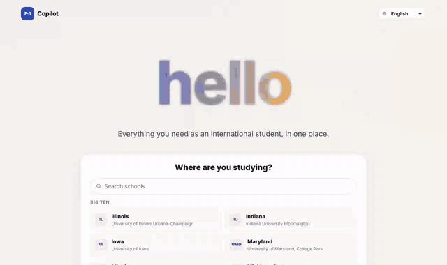
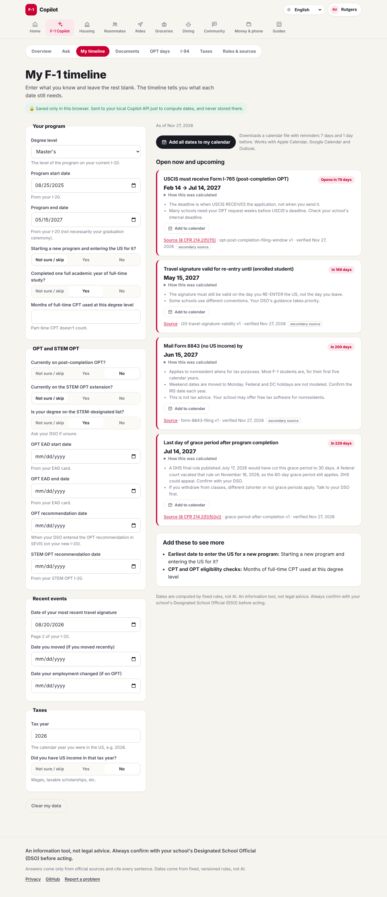
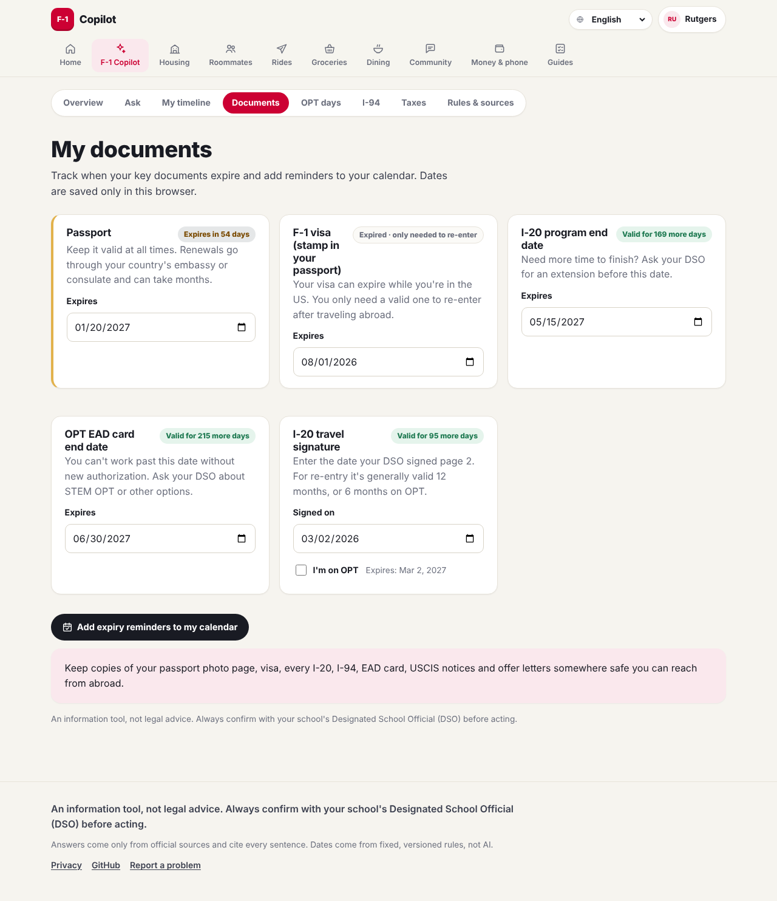
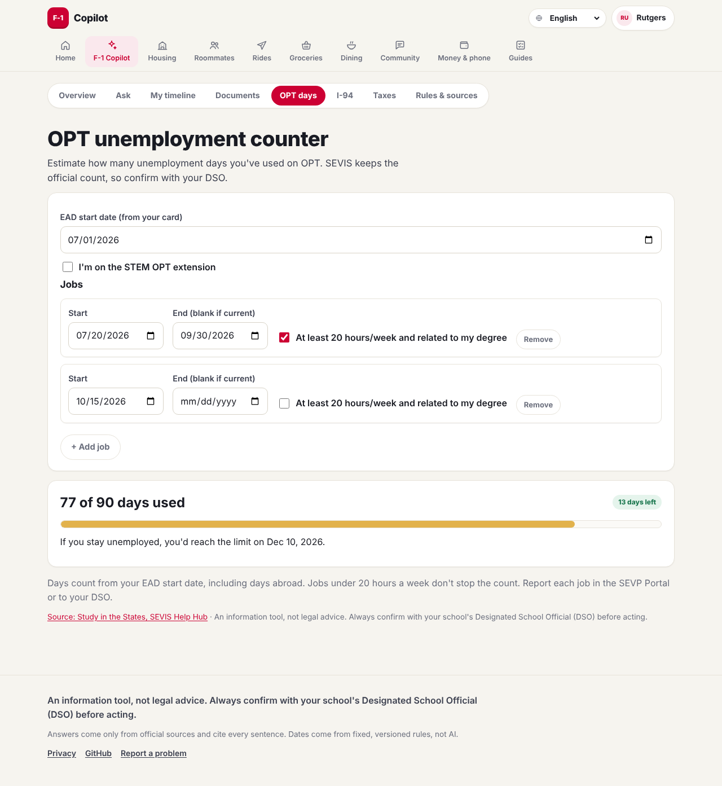
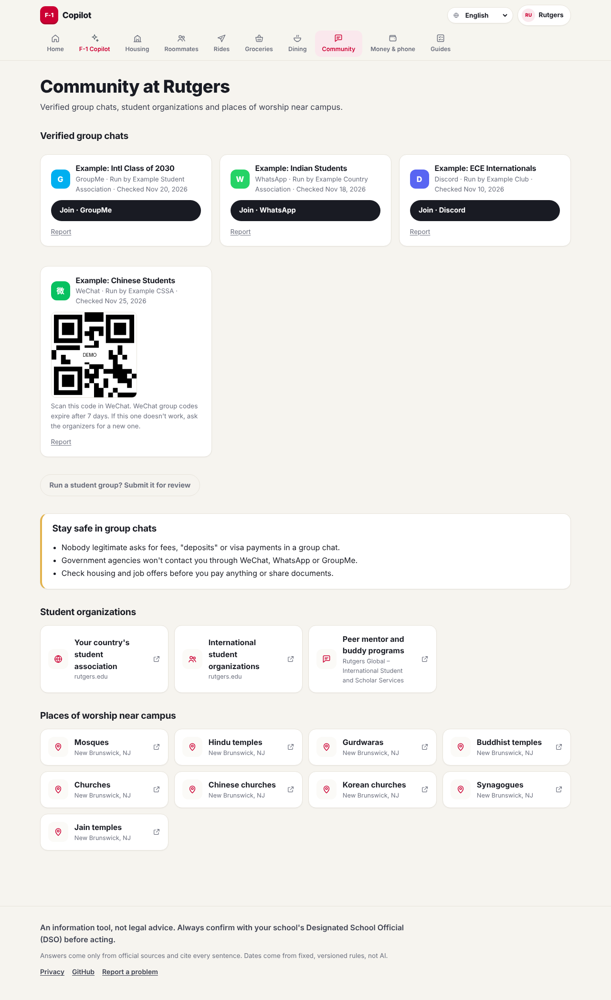
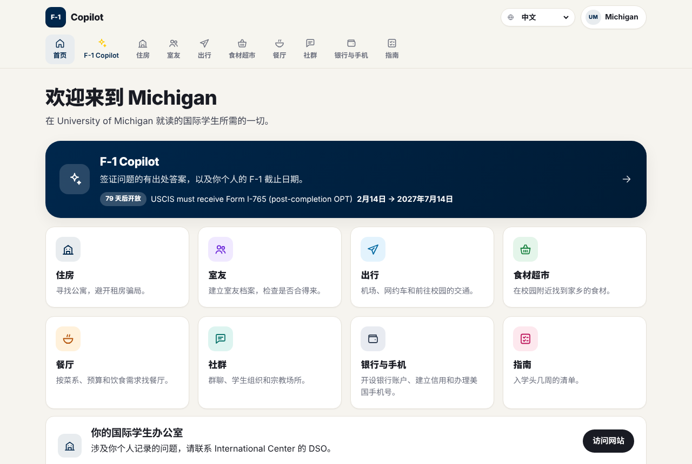
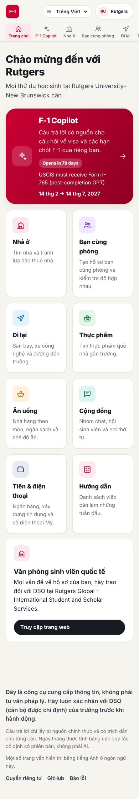
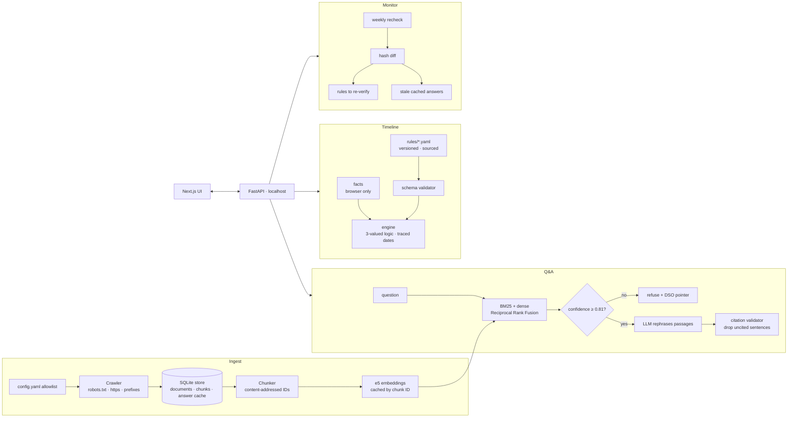

# F-1 Copilot

**Cited answers and personal deadline timelines for international students on F-1 visas, at all 18 Big Ten universities and NYU, in seven languages.**



[Watch the full 60-second demo (MP4)](docs/media/demo.mp4) · Live app: _add your Vercel URL here_

| Deadline timeline with calendar export | Document expiry tracker | OPT unemployment counter |
|---|---|---|
|  |  |  |
| **Community tab** (example data) | **Michigan theme, in Chinese** | **Phone, in Vietnamese** |
|  |  |  |

International students make high-stakes decisions, like when to file for OPT, how long they can stay after graduating, or whether their travel signature is still valid, based on guidance scattered across USCIS, DHS and university pages, plus a lot of group-chat rumor. This tool:

- **answers questions only from official sources**, in English, Chinese, Hindi, Korean or Spanish, with a citation on every sentence, and **refuses instead of guessing** when the sources don't cover a question;
- **computes a personal timeline** (OPT filing window, grace period, STEM extension, travel signature, reporting deadlines, Form 8843) with a **deterministic rules engine**. Dates never come from an LLM, and each one shows its arithmetic and its source;
- **watches the official pages for changes** and flags the rules and cached answers that depend on them;
- **keeps personal data on the user's device.**
- **has the tools students actually need:** add any deadline to your calendar (.ics with reminders), track passport, visa, I-20, EAD and travel-signature expiry, count OPT unemployment days, check your I-94, and get Form 8843 and treaty basics (highlighted every February to April);
- **is a home base for the whole move:** after a welcome screen ("hello" in 18 languages, then pick your school), a hub links the F-1 Copilot to Housing, Roommates, Rides, Groceries, Dining, Community, Money & phone and Guides. The whole app recolors itself in the student's school colors.
- **knows your school:** pick from the 18 Big Ten universities or NYU. Answers never cite another university's internal pages, and every "ask your DSO" points to your own international office.

> **This is an information tool, not legal advice.** Always confirm with your school's Designated School Official (DSO).

## Results

Evaluated on a 50-question multilingual set (30 English, 12 translated into zh/hi/ko/es, 8 off-topic) against a frozen snapshot of 532 passages from USCIS, Study in the States and ICE SEVP (`eval/results/latest.md`, Nov 2026):

| slice | n | recall@1 | recall@5 | MRR@10 |
|---|---|---|---|---|
| overall | 41 | 0.756 | **0.902** | 0.827 |
| English | 29 | 0.828 | **0.931** | 0.876 |
| Hindi / Korean | 3 / 3 | — | 1.000 / 1.000 | — |
| Chinese / Spanish | 3 / 3 | — | 0.667 / 0.667 | — |

**Refusal gate:** at the data-calibrated threshold (0.81), 8/8 off-topic questions were refused and 0/42 answerable questions were wrongly refused. The uncalibrated 0.80 let one off-topic question through.

**Caveats, stated plainly:** each non-English slice has only 3 questions, so one miss moves the score by 0.33, and 8 refusal examples are too few to fully trust a perfect score. Growing the set to ~300 with `copilot eval sample` is the next step. CI gates these numbers so they can't silently regress.

## Architecture



## Design decisions

### Q&A
- **The LLM is treated as untrusted.** It only rephrases retrieved passages. A validator removes every sentence without a citation to a passage that was actually supplied, strips hallucinated citation IDs, and refuses if nothing is left.
- **Hybrid retrieval.** BM25, implemented from scratch, catches exact identifiers ("I-20", "I-765", "STEM OPT") that embeddings blur together. Multilingual e5 embeddings catch paraphrases and other languages. Reciprocal Rank Fusion combines them by rank, so no score normalization is needed.
- **Content-addressed chunk IDs** (`sha256(url, heading, text)`). Unchanged text keeps its ID across re-crawls, so embeddings are reused and change detection is a set difference.
- **Hash visible text, not HTML**, so rotating tokens and cache-busters don't trigger false "page changed" alerts.

### Rules engine
- **Rules are data.** Each one is a YAML file with a version, source URL, verification level (primary or secondary), `last_verified` date, optional effective dates, and caveat notes. A strict schema rejects typos and bad URLs at load time, in CI.
- **Three-valued logic.** Conditions are True, False or UNKNOWN, like SQL NULL. A missing fact never quietly counts as "no". The rule reports exactly which facts it needs.
- **Explanations come from the computation.** Each date expression returns its value together with its arithmetic trace (`program_end_date 2027-05-15 + 60 days = 2027-07-14`), so the explanation can't disagree with the date.
- **Pure and deterministic.** `evaluate(rules, facts, as_of)` never reads the clock.
- **Pinned outputs.** Tests assert every shipped rule's actual dates, so changing "60 days" to "30 days" is a deliberate, reviewed change.

Why this matters: in July 2026 DHS published a rule cutting the F-1 grace period from 60 to 30 days, and a federal court vacated it in November before it took effect. The grace-period rule carries a note about it, and the change monitor exists for exactly this kind of quiet policy drift.

### Evaluation
- **Gold evidence is described by matchers** (`{"phrases": ["I-901", "fee"]}`), not hard-coded chunk IDs, which would go stale on any page edit. Matchers are resolved at run time. One that stops matching is reported, which is itself a sign the page changed.
- **CI evaluates a frozen, public-domain snapshot** and gates only deterministic metrics (recall@k, MRR, refusal). LLM-dependent metrics run locally, because non-deterministic metrics just make CI flaky.
- **Faithfulness is judged by a small local NLI model** (does the cited passage *entail* the sentence?), not by another LLM. It's English-only, and the report says so.
- **The refusal threshold is calibrated** by sweeping it and maximizing balanced accuracy (the classes are imbalanced). **Gates ratchet** to measured − 0.05.

### Schools and languages
- **School-scoped retrieval.** Sources can be tagged with a `school` in `config.yaml`. A student's question excludes other schools' pages *inside* retrieval, before ranking, so an Ohio State student can never get a Rutgers-only deadline cited back to them. Cached answers are keyed per school. Federal rules and the timeline apply to everyone.
- **Interface in seven languages.** English, 中文 and हिंदी are complete, including all 18 timeline questions. 한국어, Tiếng Việt, Español and বাংলা cover navigation, the welcome screen, the hub, Ask and every disclaimer. Missing strings fall back to English one at a time, and the footer says so. Official source passages, rule names and rule notes deliberately stay in English and are labeled as such: a mistranslated legal deadline is worse than an English sentence.
- **Dates are localized but computed in UTC**, so they never shift a day across time zones.

### Student resources
- **No invented data.** The app doesn't make up apartments, stores or restaurants for 19 cities. The Housing, Groceries, Dining and Rides tabs build live Google Maps and site-scoped Google searches around each campus (for example "Korean grocery store near West Lafayette, IN"), so results are current and every school is covered.
- **Private roommate matching.** An 8-question profile produces a share code (`RM1-` plus 8 digits) that contains no personal data. Comparing two codes gives a weighted compatibility score and the topics to discuss first (smoking and budget weigh more than cooking habits).
- **Everything personal stays in the browser:** timeline facts, roommate answers and the checklist all live in `localStorage`.
- **School themes from two colors.** Each school defines only a primary and an accent (`lib/themes.ts`). Hover, soft and deep shades are derived in CSS with `color-mix()`, so a new school is a two-line change. For schools whose signature color is a light gold, the dark partner color carries white text, which keeps contrast readable. Only colors are used, never logos or marks.
- Roommate matching logic (`lib/roommates.ts`) is unit-tested with `npm test`, and CI runs it.

### F-1 tools
- **Add to calendar.** Every upcoming timeline date has an "Add to calendar" button, plus one for all of them. `lib/ics.ts` writes RFC 5545 all-day events with 7-day and 1-day alarms, escapes text and folds long lines, so the file imports cleanly into Apple, Google and Outlook calendars.
- **OPT unemployment counter.** `lib/unemployment.ts` counts days from the EAD start date. Only jobs of at least 20 hours a week stop the count, overlapping jobs are merged, and the limit is 90 days (150 with STEM). It shows the date you'd reach the limit if you stayed unemployed. Unit-tested against hand-worked cases.
- **Document vault checklist.** Passport, visa, I-20 end date, EAD end date and travel signature (12 months, or 6 on OPT, with month-end clamping). Each gets a status and optional reminders 90, 30 and 7 days ahead. An expired visa is shown neutrally, because it only matters for re-entry. Only dates are stored, never document numbers or scans.
- **I-94 helper and tax season mode.** Step-by-step for the official CBP site, what to check, and a note on the vacated 2026 fixed-admission-period rule. From February through April, the hub and F-1 pages highlight Form 8843, Form 1040-NR, the five-year exempt-individual rule and tax treaties, linking only to IRS pages.

### Form 8843 helper
- **Every F-1 student files Form 8843 each year**, even with no income. The helper asks a few questions and produces a line-by-line answer sheet for the official IRS form, plus where and when to mail it.
- **Days are counted for you** from your arrivals and departures (any part of a day counts, overlapping trips aren't double counted, leap years handled). It checks the five-calendar-year exempt-student limit and warns when you may be a resident for tax purposes or when lines 12 or 13 need extra steps.
- **Deadlines are computed**, not hard-coded: June 15 of the next year when filing alone, or April 15 with Form 1040-NR, moved to Monday when they fall on a weekend.
- **Privacy:** answers stay in the browser, and it never asks for a passport number. "Print my answers" prints only the answer sheet. Logic in `web/lib/form8843.ts`, covered by 10 tests.

### Visa sponsor lookup
- **Search any company** to see new H-1B approvals and denials by fiscal year, approval rate, extensions, and every job title it filed with the median and range of offered salaries, plus where the jobs are. Links to the official E-Verify search, since STEM OPT requires an E-Verify employer.
- **Built from official public data:** the USCIS H-1B Employer Data Hub and Department of Labor LCA disclosure files. `copilot employers import` reads CSV or Excel, recognizes each source by its headers (both the older and newer USCIS column layouts, UTF-16 tab-separated exports, older DOL `_1` worksite columns), keeps only certified full-time H-1B filings, converts hourly or monthly wages to annual, and drops obvious data-entry errors. Re-importing a file replaces its rows instead of duplicating them.
- **Employer names are normalized** so "Google LLC" and "GOOGLE, L.L.C." are one employer across both datasets, and searches rank exact matches first, then recent new-hire approvals.
- Stored in SQLite (`data/employers.db`), queried read-only by the API. Logic in `src/copilot/employers.py`, covered by 8 tests with sample files in each official format.

### Live restaurant and grocery listings
- **Every Dining and Groceries category opens into a list** of nearby places: name, distance from campus, cuisine, diet tags (vegetarian, vegan, halal, kosher), opening hours, address, website, and an "Open in Google Maps" link.
- **Free by default, no key or account.** Listings come from OpenStreetMap (`src/copilot/osm.py`). Nominatim turns the campus city into coordinates once (cached forever, requests spaced 1 second apart). One Overpass query per city fetches every named restaurant, café and food shop within 6 km, cached on disk for 7 days, and the server sorts them into the 29 categories itself. That's at most about 19 queries a week for all campuses, well inside the public servers' fair-use policies, with a daily cap as a backstop and stale-cache fallback if a server is down. Every request identifies the app with a User-Agent, and lists credit "© OpenStreetMap contributors".
- **Category rules are unit-tested** against sample map data (cuisine tags, shop names like "Patel Brothers" or "H Mart", diet tags, and closing times after 11 pm for late-night food). When a place is mapped twice (a point and a building), the more complete record wins.
- **Optional Google Places.** Set `GOOGLE_PLACES_API_KEY` and the same dropdowns show photos, star ratings and "what it's known for" instead. This requires a Google billing account, so it's off unless you choose it. The key stays on the server, only allowlisted categories can be searched, and a daily budget keeps usage inside Google's free monthly amount.

### Community, money and phone
- **Verified group chats.** `web/data/communities.json` lists groups per school with platform, owner and the date a maintainer last checked them. It ships empty on purpose: links are added only after checking a group with its organizers. `npm test` rejects any link that isn't https on an allowlisted invite domain (GroupMe, WhatsApp, Discord, Telegram, Slack), including look-alike domains, credentials in URLs and non-invite paths. WeChat groups have no web links, so they use a QR image with a note that codes expire after 7 days. Every group has a Report link, and students can submit a group through a prefilled GitHub issue. A safety note warns about fee and "deposit" scams.
- **Student organizations, buddy programs and places of worship** link to site-scoped searches on the school's own domain and map searches near campus, so nothing is invented or goes stale.
- **Money & phone** covers opening a bank account (requirements vary, so call ahead), building credit from zero, and eSIM and prepaid plans, with no claims about specific banks.

### Accessibility and privacy
- **Keyboard and screen readers.** A skip link is the first Tab stop (checked in a headless browser), every input has a label, the language picker is a labeled `<select>`, progress bars use `role="progressbar"`, icons are `aria-hidden`, focus rings use the school color, and animations respect `prefers-reduced-motion`.
- **Contrast is tested for every school.** `lib/contrast.test.ts` computes WCAG 2.1 ratios for all 19 themes wherever text sits on them: white on primary, primary on the page, primary on tinted chips, and text on the warning tint. It caught UCLA Blue at 4.44:1 on chips, so UCLA now uses the darker blue from its own palette.
- **Privacy page** (`/privacy`) says exactly what stays in the browser and what reaches the server, and has a button that clears everything the app stored on the device.
- **Anonymous analytics, off by default.** Set `NEXT_PUBLIC_PLAUSIBLE_DOMAIN` to load Plausible (no cookies, no cross-site tracking). The error page reports only an error's type, never its message or any personal data.

### Web app and monitoring
- **Privacy by construction.** Timeline facts live in the browser's `localStorage`. The API computes the timeline and discards the facts, with no persistence, no logging and `Cache-Control: no-store`. A test asserts the data directory is byte-for-byte unchanged after a timeline request. CORS allows only the local UI unless `COPILOT_ALLOWED_ORIGINS` names your deployed site.
- **Thin framework layer.** All behavior lives in `api/service.py` and is tested with plain function calls. `api/app.py` is about 70 lines of FastAPI.
- **Change detection closes the loop.** `copilot recheck` re-crawls and diffs page hashes. It reports changed, new and unreachable pages and the chunks added or removed, flags rules whose source changed, lists rules whose source isn't crawled (IRS, eCFR), and marks only the cached answers that cited a changed page as stale. A weekly GitHub Action diffs against the snapshot and **opens an issue** listing the rules to re-verify.
- **Dates are formatted in UTC in the UI.** `new Date("2027-05-15")` is UTC midnight, so formatting it in New York time would show May 14. That's a small bug with real consequences for a deadline tool.

## Deploy

**Web app on Vercel.** Import the repo, set **Root Directory** to `web`, and add the environment variable `NEXT_PUBLIC_API_URL` with your API's URL. Optionally add `NEXT_PUBLIC_PLAUSIBLE_DOMAIN`.

**API in Docker.** The `Dockerfile` installs CPU-only PyTorch, crawls the allowlisted sources and embeds them at build time, so the server starts with a ready index. It needs about 1.5 GB of RAM, so use an instance with 2 GB:
- **Render:** New → Blueprint → this repo (`render.yaml` selects the 2 GB Standard plan; the 512 MB free plan runs out of memory).
- **Fly.io:** `fly launch --no-deploy`, then `fly deploy` (`fly.toml` asks for 2 GB and stops the machine when idle).

On either host, set `COPILOT_ALLOWED_ORIGINS` to your Vercel URL, and optionally `GOOGLE_PLACES_API_KEY` for live listings. Rebuild the image to refresh the corpus; the weekly recheck Action tells you when sources changed.

## Rule review

`python scripts/rule_review_packet.py` generates `docs/rule-review.md` from the rule files: a one-page checklist per rule for a DSO to mark correct, needs a change, or different at our school. `docs/dso-email.md` is the request email. Reviewed rules get the reviewer and date in their changelog.

## Setup (macOS, Apple Silicon)

```bash
python3 -m venv .venv
source .venv/bin/activate
pip install -e ".[dev]"
pytest
```

For generated answers, install [Ollama](https://ollama.com) and set `llm.provider: ollama`. With `provider: none` you get extractive answers: quoted passages with citations.

### Run the web app
```bash
copilot ingest
copilot serve
```
In a second terminal:
```bash
cd web
cp .env.local.example .env.local
npm install
npm run dev
```
Open http://localhost:3000. Every visit opens on the welcome screen; returning students get a one-tap Continue to their school's hub.

### Load the visa sponsor data
Download one or more files, then import them (each takes a few minutes):
- USCIS H-1B Employer Data Hub: https://www.uscis.gov/tools/reports-and-studies/h-1b-employer-data-hub → download a fiscal year as CSV
- DOL LCA disclosure data: https://www.dol.gov/agencies/eta/foreign-labor/performance → "LCA Programs (H-1B, H-1B1, E-3)" Excel file
```bash
copilot employers import ~/Downloads/Employer*.csv ~/Downloads/LCA_Disclosure_Data_FY*.xlsx
```

### CLI
```bash
copilot ask "When can I apply for OPT?" --debug
copilot timeline --facts my-facts.yaml          # my-facts.yaml is git-ignored
copilot rules check --strict
copilot eval run --corpus eval/snapshot/chunks.jsonl --check eval/thresholds.yaml
copilot eval sample --n 25                      # draft new eval items
copilot recheck                                 # update index, flag stale answers and rules
copilot recheck --baseline snapshot             # read-only diff, used by the weekly Action
```
To recheck weekly on your Mac, see `examples/launchd/com.f1copilot.recheck.plist`.

## Rules shipped (v1, verified 2026-11-27)

| Rule | What it computes |
|---|---|
| `opt-post-completion-filing-window` | I-765 window: 90 days before → min(60 days after program end, 30 days after DSO recommendation) |
| `grace-period-after-completion` | 60 days after program end, or after OPT ends |
| `stem-opt-extension-filing-window` | 90 days before EAD expiry → min(EAD expiry, 60 days after STEM recommendation) |
| `opt-unemployment-limit` | 90 days (150 with STEM extension) |
| `i20-travel-signature-validity` | 12 months (6 on OPT), capped at program end / EAD expiry |
| `address-change-reporting` | 10 days after a move |
| `opt-employment-change-reporting` | 10 days after an employer change while on OPT |
| `initial-entry-window` | No earlier than 30 days before program start |
| `practical-training-eligibility` | One-academic-year requirement; 12+ months full-time CPT blocks OPT |
| `form-8843-filing` | April 15 with income / June 15 without (weekends rolled forward) |

`secondary` rules were checked against university international-office pages because the primary page couldn't be fetched automatically. Re-verifying them against the primary source is part of maintenance.

## Project layout

```
rules/                 versioned YAML rules
examples/              example facts; macOS launchd schedule
src/copilot/
  crawler.py parsing.py chunker.py store.py indexing.py   ingestion
  bm25.py embeddings.py retrieval.py llm.py answer.py      grounded Q&A
  osm.py places.py     restaurant and grocery listings (OpenStreetMap; optional Google Places)
  employers.py         H-1B sponsor data import and search
  timeline/            facts, dates, schema, engine        deterministic rules engine
  evaluation/          dataset, metrics, faithfulness, runner, report
  changes.py           recheck + diff + stale flags
  api/service.py       framework-free service layer
  api/app.py           FastAPI routes
  cli.py               `copilot` command
web/                   Next.js app (hub, F-1 Copilot, tools, community, privacy)
  lib/                 ics, unemployment, documents, communities, contrast, i18n (+ tests)
  data/communities.json  curated, validated group links
docs/                  rule-review packet, DSO email, demo video and screenshots
scripts/               rule_review_packet.py
Dockerfile render.yaml fly.toml   API deployment
eval/                  seed dataset, thresholds, snapshot, results
.github/workflows/     ci.yml (tests, eval gates, web build) · recheck.yml (weekly monitor)
tests/                 240+ tests, offline, no model downloads
```

## Resume bullets

- Built **F-1 Compliance Copilot**, a citation-grounded RAG assistant over 532 passages from official US immigration sources. It uses hybrid BM25 + multilingual dense retrieval with Reciprocal Rank Fusion and reaches **0.90 recall@5 / 0.83 MRR** on a 50-question eval set in 5 languages, with a citation validator that strips unsupported LLM sentences.
- Designed a **deterministic, versioned rules engine** (Python, YAML) that computes students' visa deadlines with three-valued logic for missing facts and step-by-step explanations generated by the computation itself. It's covered by **240+ tests**, including pinned outputs for every rule and calendar edge cases.
- Built the **evaluation and monitoring pipeline**: a data-calibrated refusal gate (**8/8 off-topic questions refused, 0 false refusals**), ratcheting CI quality gates on a frozen corpus, NLI-based faithfulness scoring, and a weekly GitHub Action that diffs official pages and opens issues for affected rules. Shipped with a FastAPI + Next.js UI in 7 languages for 19 universities, with WCAG contrast tests for every school theme and personal data kept in the browser.
